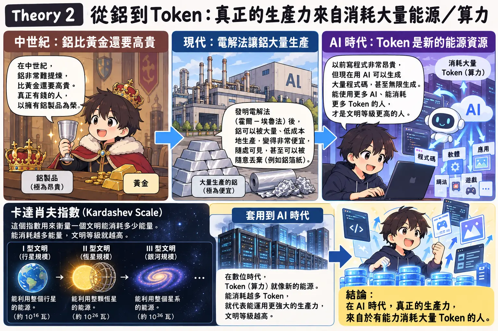
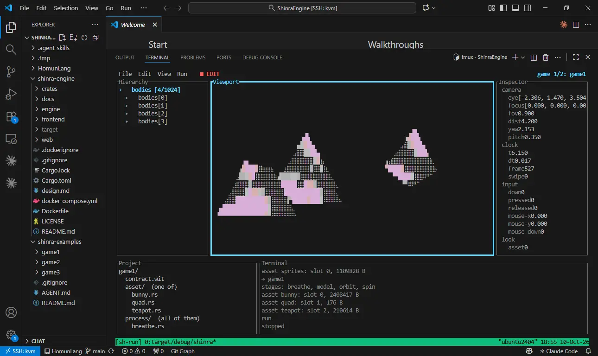
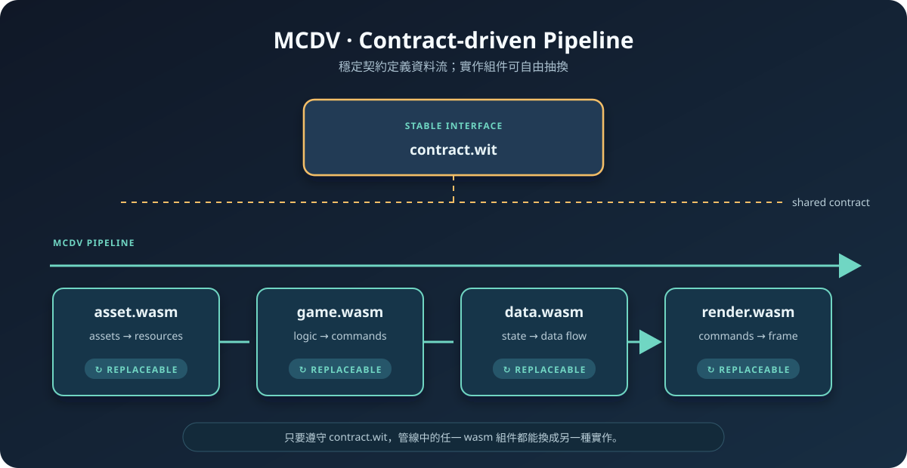

## 設計Shinra-Engine心路歷程

<video controls autoplay loop muted playsinline preload="auto" style="max-width: 100%;">
  <source src="sh-play.mp4" type="video/mp4">
  您的瀏覽器不支援內嵌影片播放。
</video>

## Theory1: 真正的資產是「產生結果的能力」


## Theory2:真正的生產力來自消耗大量算力



## Theory3: 軟體將成為下一個流量入口


## 結論

根據以上三個理論

創造一個工廠系統，無限消耗token，生成軟體的人 是未來的資產持有者

我的目標： gametok 一個往右滑換小遊戲的平台 -> 即無限垃圾廣告小遊戲平台


## 限制

**理想很豐滿 現實很骨感**

大量用AI生產，會快速累積大量技術債

AI會寫垃圾


## 解方

根據第一性原理：AI會寫垃圾

設計出 "限制爆炸範圍"


## 實驗1: 統一後端

概念：激進的GraphQL

產出：LC(Lattice-Cast)

### 基於以下第一性原理的產物
* AI會寫垃圾，所以需要限制爆炸半徑
* 任何想法重點在於實驗驗證速度，LC是快速迭代的方法論
* 客戶無法 Crystallize Domain Know-how，所以需要FDE

### LC湧現: 
LC可以做不同的前端app統一後台 再也不用寫BE(自帶oauth2)
* 爬蟲後台，ex: 591租屋爬蟲用的閱覽器
* AHLC(Agentic-Hive+Lattice-Cast)，可以讓不同AI協作的框架 ex: codex as Queen,  hermes+deepseek as Bee
* 日歷復盤系統
* SEO文章生成器
* ....


## 實驗1: 概念


## 實驗2: game engine:

我要能hot replacement

gametok終於開始嘗試


## 嘗試2-1: 自製DSL

https://github.com/homun-lang/homun 

```
// Quicksort — recursion + pipe
quicksort := (arr) -> {
  if (len(arr) <= 1) { => arr }
  pivot := arr[0]
  rest  := arr[1:]
  left  := rest | filter((x) -> { x <= pivot })
  right := rest | filter((x) -> { x > pivot })
  quicksort(left) + @[pivot] + quicksort(right)
}

// DFS — recursive
dfs := (graph, node, visited) -> {
  if (node in visited) { => visited }
  visited ::= visited + @[node]
  for neighbor in graph[node] {
    visited ::= dfs(graph, neighbor, visited)
  }
  visited
}


// Pattern Match
fizz_buzz := (n: int) -> @[str] {
  result ::= @[]
  for i in range(1, n+1) {
    value := match (i % 3, i % 5) {
      (0, 0) -> "FizzBuzz"
      (0, _) -> "Fizz"
      (_, 0) -> "Buzz"
      _         -> str(i)
    }
    result ::= result + @[value]
  }
  result
}
```

## 嘗試2-2: SE in vsc

<video controls autoplay loop muted playsinline preload="auto" style="max-width: 80%;">
  <source src="sh-vsc.mp4" type="video/mp4">
  您的瀏覽器不支援內嵌影片播放。
</video>

遇到問題:
* 開發困難 進度遲緩

目標解方：
* 製作AI專用的生成遊戲系統 -> TUI Game Engine 讓AI可以自迭代


## 嘗試2-3: SE in tui




## 嘗試2-4 重構:

設計成MVC-like

* bundle.so(data.rs, buffer.rs)
* game.so(control)
* ecs.so(data pipeline)
* render.so(render pipeline)
* asset.so(model meterial)

遇到問題
* rust ABI not stable
* hecs not friendly to my design

## 嘗試2-5 MCDV:

最終以wasm作為基礎 做了 MCDV




## End

Thanks for Listening


## Appendix: LC

原理：pg GIN idx on jsonb with RLS

| workspace_id | table_id | row | jsonb |
| --- | --- | --- | --- |
| 1 | 1 | 1 | `{"type":"user","name":"Alice","roles":["admin"]}` |
| 1 | 1 | 2 | `{"type":"order","id":101,"status":"paid"}` |
| 1 | 1 | 3 | `{"type":"product","sku":"KB01","tags":["usb","keyboard"]}` |
| 1 | 1 | 4 | `{"type":"log","level":"error","service":"api"}` |
| 1 | 3 | 1 | `{"type":"payment","amount":500,"status":"failed"}` |
| 1 | 3 | 2 | `{"type":"sensor","temp":27.4,"room":"A7"}` |
| 2 | 4 | 1 | `{"name":"Alice","roles":["admin"]}` |
| 2 | 4 | 2 | `{"order_id":101,"status":"paid"}` |
| 2 | 5 | 1 | `{"sku":"KB01","price":999}` |
| 2 | 6 | 1 | `{"level":"error","service":"api"}` |
| 2 | 7 | 1 | `{"device":"T01","temp":27.4}` |

pg做得比mongoDB好： 

<div class="embed_youtube" yt-title=" 为什么关系数据库的挑战者都没有好下场【让编程再次伟大#25】 " yt-url="IUUpxfa1SSw" yt-width="700">
  <p>Loading content…</p>
</div>
